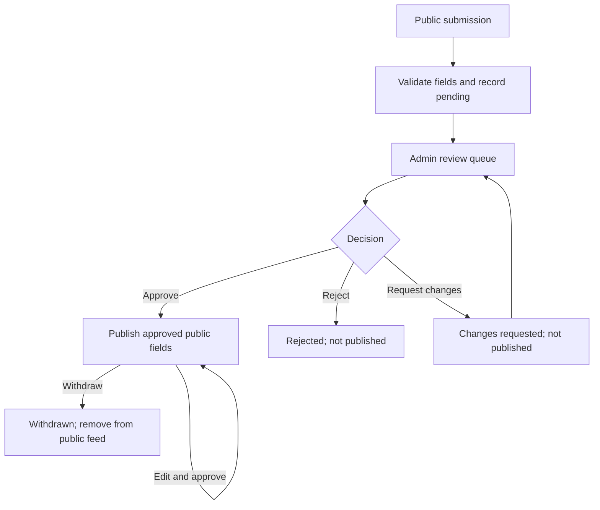

# NIWFF website design

## Purpose and architecture

The NIWFF website is the federation's authoritative information and publication platform. It serves prospective players, affiliated and prospective clubs, international squads, event organisers and the website administration team. Social media complements the website; the approved NIWFF Facebook Group is https://www.facebook.com/groups/602931127880903/ . The Irish FA website is https://www.irishfa.com/ . The proposed general contact address is info@niwalkingfootball.com, pending mailbox provisioning and delivery testing.

The current implementation combines HTML/CSS/JavaScript public pages with PHP 8.1+ and PDO MySQL/MariaDB submission, review and publication services. The Git checkout remains the cPanel document root, with Apache denying access to repository metadata, migration archives, scripts and project documentation. Database configuration and credentials live outside the web root. No separate build or copy operation is required for normal deployment.

## Information architecture

| Page | Purpose |
| --- | --- |
| Home | Introduction, find a club, events, representative teams, current news |
| Find a Club | Searchable club directory, club profiles, Register My Club |
| Events | Forthcoming monthly calendar, event details, Create an Event, Past Events |
| International Teams | Age-group squad pages, current squad and management, fixtures, results, historical reports |
| News | News and match reports |
| Photos | Photo collections by event and year |
| Resources | Rules and guidance, Irish FA resources |
| About | Federation purpose, governance, policies |
| Contact | Federation contact and Facebook Group |
| Administration | Authenticated review queue, decisions, audit history |

Historical collections use the same rolling current year plus four previous calendar years and OLDER tabs, e.g. 2026 | 2025 | 2024 | 2023 | 2022 | OLDER. They roll forward on 1 January UK time. Undated records remain separately identified. Approved events move to history after their end date.

## Roles and permissions

| Role | Permissions |
| --- | --- |
| Public visitor | Browse approved public records; view clearly labelled historical content; submit event or club information |
| Club representative | Submit club registration or event details; provide private contact for clarification |
| Website administrator | Sign in, review submissions, edit public fields, approve, reject, request changes, withdraw, inspect decision history |
| Hosting/database operator | Provision database, manage credentials and named admin accounts, maintain backups and hosting security |

A public submission is not proof of club identity, authority to represent a club, or formal federation affiliation. Administrators must verify eligibility and legitimacy before approval. Club accounts, identity verification and self-service revisions are future enhancements.

## Shared approval lifecycle

Every new submission starts pending. The website displays a reference number on successful submission. Administrator decisions are explicit, authenticated and audit logged. Only approved records with a publication timestamp enter the public feed. Rejected, pending, changes-requested and withdrawn records remain private. A withdrawn approved club may still have a separately labelled legacy archive entry until that legacy record is reconciled; it must not be presented as an approved listing.

Current implementation permits administrators to revise the submitted public fields while making a decision. Request-changes notes remain internal; automated email to the submitter, resubmission links and versioned approval of changes are planned, not implemented. Administrators may contact the private representative manually. Optional admin notification email requires verified sender and recipient settings; the queue remains authoritative.

## Create an Event

Entry point: Events page, Create an Event button; form route `/submit.php?kind=event`.

### Input and presentation

- Required: event title, organising club, event type, start date, venue/address, description, private representative name and email, acknowledgement of data use.
- Optional: end date, start/end times, age groups/eligibility, fees/entry details, registration/information URL and poster URL.
- Dates are ISO calendar dates; end date cannot precede start date. Times are UK local time. URLs must use HTTP(S). Required fields, lengths and emails are validated on the server.
- The form provides clear labels and validation messages, and does not imply that submission equals publication.

After approval, the event appears in the forthcoming calendar and chronological event list, with date, organiser, location and expandable details. After the final event date, it moves automatically to Past Events and the relevant year tab. Historical listings do not imply verified results. Withdrawal removes the database-backed event from the feed.

Future: authenticated club association, time-structured fixtures, uploaded posters, duplicate detection, amendment workflow, copy-ready Facebook Event details and optional supported Facebook integration.

## Register My Club

Entry point: Find a Club page, Register My Club button; form route `/submit.php?kind=club`.

### Input and presentation

- Required: club name, council area, town/location, venue/address, session schedule, age categories and session categories (men's/women's/mixed as relevant), description, private representative name and email, acknowledgement of data use.
- Optional: membership/session costs, accessibility, website, social media URL and deliberately public club email.
- Representative contact details are separate from the public club contact field.
- Administrators verify registration details and suitability for directory listing. Approval publishes a searchable club card and detailed profile. Rejection or withdrawal removes the approved record. Website registration is separate from formal NIWFF affiliation unless the federation explicitly decides otherwise.
- Legacy club listings are labelled unverified; an approved record with a matching normalised name suppresses the legacy listing while approved. Duplicate reconciliation and robust identity matching remain outstanding.

Future: club logos and secure uploads, multiple structured venues/sessions, club accounts, approval of subsequent changes, scheduled record confirmation, and separate affiliation management if required.

## Administration screen

Route `/admin/`. Named admin accounts are created by a hosting operator through the CLI; passwords are hashed, not stored in plaintext. The review queue shows submission reference, type, status and received date, with pending items first. A review screen shows private representative contacts, editable public fields, decision selector, internal note and decision history. The current dashboard lists the latest 500 submissions; paging, filtering and search are future improvements.

| State | Publicly visible? | Meaning |
| --- | --- | --- |
| pending | No | Awaiting review |
| changes_requested | No | Clarification/amendment needed |
| rejected | No | Not accepted |
| approved | Yes | Reviewed and published |
| withdrawn | No | Previously accepted record removed from public feed |

## Database and publication contract

| Table | Responsibilities |
| --- | --- |
| admins | Unique username, password hash, active status |
| submissions | Kind, JSON form payload, private contact name/email, status, reviewer note, timestamps, reviewer reference |
| review_log | Submission/admin references, old/new status, note and decision timestamp |

`submissions.reviewed_by` references `admins.id`; review log records reference both submission and administrator. Admin review updates and audit entries are transactional. No personal details, internal notes or login data are included in the public API.

`/api/public.php` returns JSON with separate clubs and events collections, filtered to approved records and allow-listed public fields. Existing JavaScript public pages load this feed. The initial archive migration data remains separate and unverified. The API does not publish draft submissions.

Database-backed approval is the source of truth for new registrations and events. The initial JSON payload design simplifies staging; normalised club, venue, session, event, media and revision tables should be evaluated as the feature set expands. Retention, audit integrity, backup and deletion processes require federation agreement.

## Security, privacy and operation

Implemented controls include prepared statements, server-side validation, escaped output, CSRF tokens, named admin accounts, password hashing, secure/HttpOnly/SameSite session cookies, session expiry, basic submission throttling and a honeypot. Configuration resides at ~/niwff-private/config.php, outside the document root. Staging uses HTTPS and noindex; noindex is not access control.

Before inviting real clubs: verify Apache restrictions, establish privacy notices and retention/deletion policy, add robust server-side rate limiting (the initial session-based controls are insufficient for distributed abuse), review authorisation and public field exposure, test duplicate submissions and simultaneous reviews, verify backups/restore, configure admin access revocation and notification delivery, and use test data for end-to-end acceptance. Secure media uploads must be validated and isolated before enabling.

## Implementation status and acceptance

The forms, database schema, authenticated review queue, publication feed, calendar and directory integration are committed to the recovery branch. Database provisioning and end-to-end PHP/MySQL/browser testing on clannEolas remain outstanding. Do not treat the workflow as production-ready.

Acceptance: pending submissions are persisted but absent from public views; admin approval publishes the correct record; rejected/withdrawn records are absent from the approved feed; private contacts and notes never appear in public responses; completed events enter the correct archive year; invalid data and unauthorised reviews are refused; administrators can inspect decision history.

See [database workflow setup and acceptance checklist](databaseWorkflows.md), [staging deployment](stagingDeployment.md), [content migration model](contentMigrationModel.md) and [requirements](../REQUIREMENTS.md).
